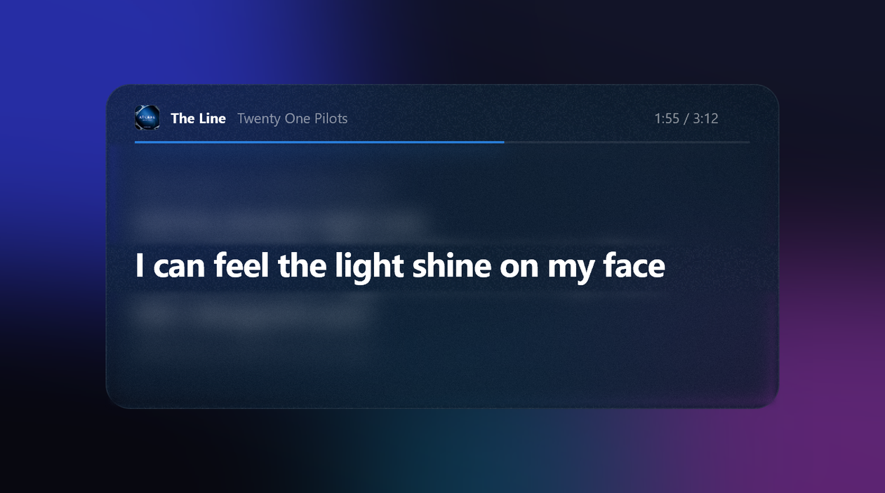
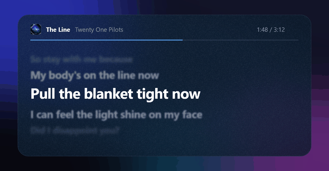
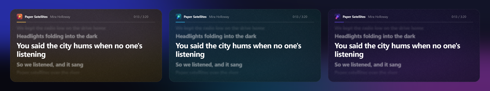
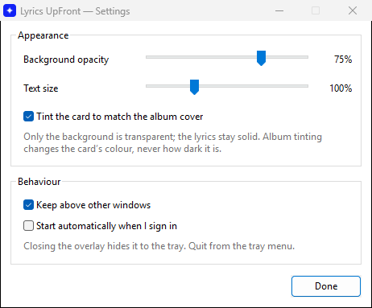

<div align="center">


# Lyrics UpFront

**Synced lyrics, right up front.**<br>
A floating lyrics overlay for Spotify on Windows: transparent, always on top, and about 1 MB.

[](#requirements)
[](#light-by-design)
[](https://github.com/ijuice-j/lyrics-upfront/releases/latest)
[](LICENSE)

<a href="https://github.com/ijuice-j/lyrics-upfront/releases/latest/download/LyricsUpFront-Setup.exe"></a>
&nbsp;
<a href="https://github.com/ijuice-j/lyrics-upfront/releases/latest/download/LyricsUpFront-portable.exe"></a>

<sub>Free · no account · no API key · no telemetry</sub>

<br>



</div>

---

Play a song in Spotify and its lyrics appear in a small glass card on your desktop. The line being sung lights up the moment it starts, and the lines around it fade back. The card floats above your other windows, so the words stay in view while you work, browse or play.

## Every line, right on time

<p align="center"></p>

Lyrics come with a timestamp for every line. Lyrics UpFront lights each line up exactly when its timestamp arrives, so it is never early or late.

When the song moves on, the whole stack rises, the next line pulls into focus and the last one softens into the background. Lines further away blur more, so your eye always lands on the one you need.

## Colours from the cover



The card takes its colour from the album art of whatever is playing, then crossfades when the track changes. The cover only supplies the hue. The card stays dark and the lyrics stay white, so a bright or busy cover can never make the words hard to read.

## What you get

| | |
|---|---|
| **Floats over everything** | Stays above other windows, including games in borderless mode. Click-drag it anywhere and resize it from any edge. It remembers where you left it. |
| **Works on its own** | No sign-in, no Spotify developer account, no API key. It reads the track from Windows, the same place the volume flyout gets it. |
| **Shows where you are** | A thin progress line under the title fills as the song plays, with elapsed and total time beside it. |
| **Stays out of the way** | Lives in the system tray, not the taskbar or Alt-Tab. Click the icon to show or hide the card; closing it hides it rather than quitting. |
| **Works offline after the first play** | Lyrics are cached the first time a song plays, so replays are instant and need no connection. |
| **Starts with Windows** | Optional, from Settings. |

## Light by design

Lyrics UpFront is a native Windows app. Drawing, text, images and networking all come from Windows itself, so nothing heavy is bundled, and it only redraws when something on screen actually changes.

| | Lyrics UpFront | Earlier version (Python) |
|---|---|---|
| Download | **about 1 MB** | 144–218 MB |
| CPU while a song plays | **under 1% of one core** | about 70% |
| Memory | **about 70 MB** | about 290 MB |
| Processes | **1** | 3 |
| Start to visible | **about 0.3 s** | about 1.2 s |

<sub>Measured on the same laptop (Intel i7-9750H) with the same song. See [how it works](docs/how-it-works.md) for the method.</sub>

## Install

1. Download **[LyricsUpFront-Setup.exe](https://github.com/ijuice-j/lyrics-upfront/releases/latest/download/LyricsUpFront-Setup.exe)** and double-click it. It installs just for you, so it needs no administrator password.
2. Open Spotify and play something. The card appears with the lyrics.

Prefer not to install? **[LyricsUpFront-portable.exe](https://github.com/ijuice-j/lyrics-upfront/releases/latest/download/LyricsUpFront-portable.exe)** is the whole app in one file. Put it anywhere and run it.

> [!NOTE]
> Windows SmartScreen may warn about an unrecognised app, because the app is not code-signed (a certificate is an ongoing paid expense). Click **More info → Run anyway**. Every line of the source is here if you'd rather [build it yourself](#build-from-source).

**Upgrading from the earlier version?** The installer replaces it. Your card position, settings, cached lyrics and start-with-Windows choice all carry over.

## Settings



Right-click the tray icon and choose **Settings…**. Every change applies as you make it.

- **Background opacity**: how see-through the card is. Only the background changes; the lyrics stay solid.
- **Text size**: makes the lyrics larger or smaller.
- **Tint the card to match the album cover**: turn album colours on or off.
- **Keep above other windows**: always on top.
- **Start automatically when I sign in**: launch with Windows.

<br clear="right">

## Questions

<details>
<summary><b>Do I need a Spotify account, developer key or login?</b></summary>
<br>
No. Lyrics come from <a href="https://lrclib.net">LRCLIB</a>, which is free and needs no key, and the current track comes from Windows. Nothing asks you to sign in.
</details>

<details>
<summary><b>Does it work with other music players?</b></summary>
<br>
Usually, yes. It prefers Spotify, but any player that reports what's playing to Windows (the one that shows up in the volume flyout) works, including many browsers.
</details>

<details>
<summary><b>Why are the lyrics missing for some songs?</b></summary>
<br>
LRCLIB is a community library, so some tracks have no timed lyrics yet. When a song only has plain lyrics, the card shows its opening lines without timing. You can add missing lyrics to LRCLIB yourself, and they'll appear for everyone.
</details>

<details>
<summary><b>The first play of a song takes a moment. Why?</b></summary>
<br>
The lyrics are downloaded the first time a song plays, usually in under a second or two. After that they're cached on your PC, so the next play is instant, even offline.
</details>

<details>
<summary><b>How do I uninstall it?</b></summary>
<br>
Settings → Apps → <b>Lyrics UpFront</b> → Uninstall. Your preferences live in <code>%USERPROFILE%\.lyrics-upfront</code> and are left behind on purpose, so reinstalling keeps your layout; delete that folder to remove them too.
</details>

## Requirements

- Windows 10 or 11
- The Spotify desktop app, or another player that reports to Windows
- An internet connection the first time each song plays

## Build from source

You need [Rust](https://rustup.rs). Either the MSVC or the GNU toolchain works, and no C compiler is needed.

```bat
git clone https://github.com/ijuice-j/lyrics-upfront.git
cd lyrics-upfront
cargo build --release
target\release\lyrics-upfront.exe
```

`cargo test` runs the lyric timing, colour and icon tests. To build the installer, install [Inno Setup](https://jrsoftware.org/isinfo.php) and run:

```bat
target\release\lyrics-upfront.exe --write-icon app.ico
"%LOCALAPPDATA%\Programs\Inno Setup 6\ISCC.exe" installer.iss
```

Pushing a `v*` tag builds everything on GitHub Actions and publishes a release.

## How it works

```
 Spotify ──► Windows media session ──► track, artist, playhead, cover art
                                             │
                     LRCLIB ◄── lyrics lookup ┤ cover colour
                                             ▼
                        Direct2D + DirectWrite card on a transparent,
                        always-on-top DirectComposition window
```

Windows reports the playhead as a snapshot plus the time it was taken, so the app corrects for its age and keeps its own clock between updates. It sleeps until the next visible change (the next line, the clock ticking over, or the progress line moving a pixel) and draws at full frame rate only while a line is rolling into place. [docs/how-it-works.md](docs/how-it-works.md) has the details and measurements.

## Privacy

Everything runs on your PC. The only network requests are lyric lookups to LRCLIB. No analytics, no telemetry, and nothing about you is uploaded.

## Credits

- Lyrics by [LRCLIB](https://lrclib.net), a free, open lyrics library.
- Text set in [Mona Sans](https://github.com/github/mona-sans) by GitHub, under the SIL Open Font License.
- Lyrics UpFront grew out of [Spotify Lyrics Overlay](https://github.com/ijuice-j/spotify-lyrics-overlay).

## Licence

MIT, see [LICENSE](LICENSE).

Lyrics UpFront is not affiliated with, endorsed by or connected to Spotify AB or any artist shown. The screenshots show songs by Twenty One Pilots, with lyrics from LRCLIB, as the app displays them. Song titles, lyrics and artwork belong to their owners.

<sub>Keywords: spotify lyrics overlay · floating lyrics windows · picture in picture lyrics · always on top lyrics · synced lyrics desktop app · spotify mini player lyrics · karaoke lyrics overlay for pc · real-time lyrics windows 10 11</sub>
